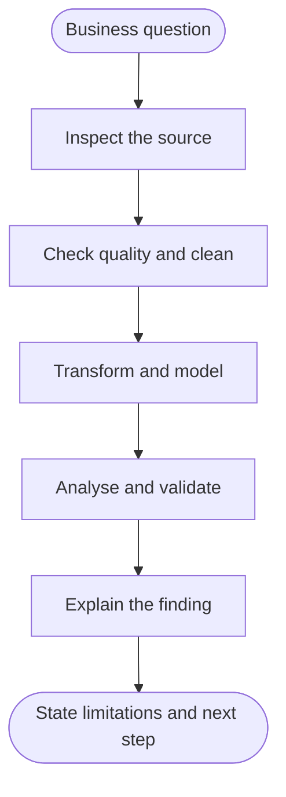

  
   
  <h1>SHANMUKH KOYYA</h1>
  
<b>DATA ANALYST · BUSINESS INTELLIGENCE · CONTINUOUS LEARNER</b>

  
<i>I turn raw tables into clear questions, checked analysis and useful explanations.</i>

  
  

---

<table>
  <tr>
    <td width="33%" valign="top">
      <b>01 / MY FOCUS</b>
      <h3>Make data usable.</h3>
      I am building practical skills for entry-level Data Analyst and BI Analyst roles through structured learning and hands-on projects.
    </td>
    <td width="33%" valign="top">
      <b>02 / MY METHOD</b>
      <h3>Check before concluding.</h3>
      I inspect data quality, document transformations, compare results and call out assumptions instead of hiding them.
    </td>
    <td width="33%" valign="top">
      <b>03 / MY TOOLKIT</b>
      <h3>Choose the right tool.</h3>
      SQL · Excel · Power Query · Power BI · DAX · Python · NumPy · Pandas
    </td>
  </tr>
</table>

## The project desk

*Four projects that show the kind of questions I practise answering.*

<table>
  <tr>
    <td width="50%" valign="top">
      CASE FILE 01 · SQL / MYSQL
      <h3>Customer retention investigation</h3>
      **Question:** What patterns distinguish active and churned customer records?

      Cleaned and explored customer data, compared tenure by status, and examined complaint flags alongside churn.

      <a href="https://github.com/shanmukhkoyya/ecommerce-customer-churn-analysis">OPEN CASE FILE ↗</a>
    </td>
    <td width="50%" valign="top">
      CASE FILE 02 · EXCEL / POWER QUERY / POWER BI
      <h3>Streaming catalogue exploration</h3>
      **Question:** What does the supplied content catalogue look like across title type, genre, rating and geography?

      Prepared the dataset and developed a reporting project around catalogue exploration.

      <a href="https://github.com/shanmukhkoyya/netflix-content-analysis">OPEN CASE FILE ↗</a>
    </td>
  </tr>
  <tr>
    <td width="50%" valign="top">
      CASE FILE 03 · POWER QUERY / POWER BI / DAX
      <h3>Sales transformation & data model</h3>
      **Question:** How can prepared sales tables support consistent reporting?

      Documented the transformation workflow, table structure and category-level sales and profit measures.

      <a href="https://github.com/shanmukhkoyya/Data-Transformation-Data-Modeling-using-Power-BI">OPEN CASE FILE ↗</a>
    </td>
    <td width="50%" valign="top">
      CASE FILE 04 · POWER BI / DAX
      <h3>Work patterns in sample data</h3>
      **Question:** What patterns appear across a small set of activity records?

      Explored task and work-mode comparisons while treating the custom productivity index as an exploratory measure—not a validated HR metric.

      <a href="https://github.com/shanmukhkoyya/employee-laziness-productivity-analysis">OPEN CASE FILE ↗</a>
    </td>
  </tr>
</table>

## One result, with context

### Customer churn · documented project figures

<table>
  <tr>
    <td align="center" width="25%"><h2>5,628</h2>records after cleaning</td>
    <td align="center" width="25%"><h2>16.84%</h2>documented churn rate</td>
    <td align="center" width="25%"><h2>4,680</h2>active records</td>
    <td align="center" width="25%"><h2>948</h2>churned records</td>
  </tr>
</table>

**What I take from it:** the churned group showed lower average tenure than the active group in this dataset. That is a descriptive pattern, not proof of what caused churn. The SQL and project documentation are available in the [customer churn repository](https://github.com/shanmukhkoyya/ecommerce-customer-churn-analysis).

Figures are specific to the supplied learning dataset and documented project workflow; they are not live-company metrics or industry benchmarks.

## How I approach an analysis

## The workbench

*Smaller exercises and technical practice that support the case studies above.*

| WORKBENCH | WHAT I PRACTISE |
|---|---|
| [Python · NumPy & Pandas](https://github.com/shanmukhkoyya/Python-Data-Analysis-NumPy-Pandas) | Data inspection, cleaning, filtering, grouping and summary statistics |
| [Survey feedback analyzer](https://github.com/shanmukhkoyya/survey-feedback-analyzer) | Text cleaning and rating summaries in a notebook |
| [Analytics coding challenge](https://github.com/shanmukhkoyya/analytics-coding-challenge) | Short, multi-tool analytics exercises |
| [MySQL querying practice](https://github.com/shanmukhkoyya/mysql-assignment-2-querying-data) | SELECT queries, joins, filters and aggregations |
| [Power BI · DAX practice](https://github.com/shanmukhkoyya/PowerBI---DAX-Data-Visualization) | Measures and report visualisation |

## Tools I am developing

  
  
  
  
  
  
  
  

## Learning path

- **AI-Driven Data Analytics** — Entri Software Pvt. Ltd.
- **Salesforce Certified Agentforce Specialist** — November 14, 2025
- **B.Tech** — Electrical & Electronics Engineering

---

  <h3>Have a question, opportunity or useful feedback?</h3>
  <a href="https://shanmukhkoyya.github.io">PORTFOLIO</a> &nbsp; · &nbsp;
  <a href="https://www.linkedin.com/in/shanmukh-koyya/">LINKEDIN</a> &nbsp; · &nbsp;
  <a href="mailto:shanmukhkoyya1234@gmail.com">EMAIL</a>
    
  Built with curiosity. Improved through practice. Documented with honesty.

